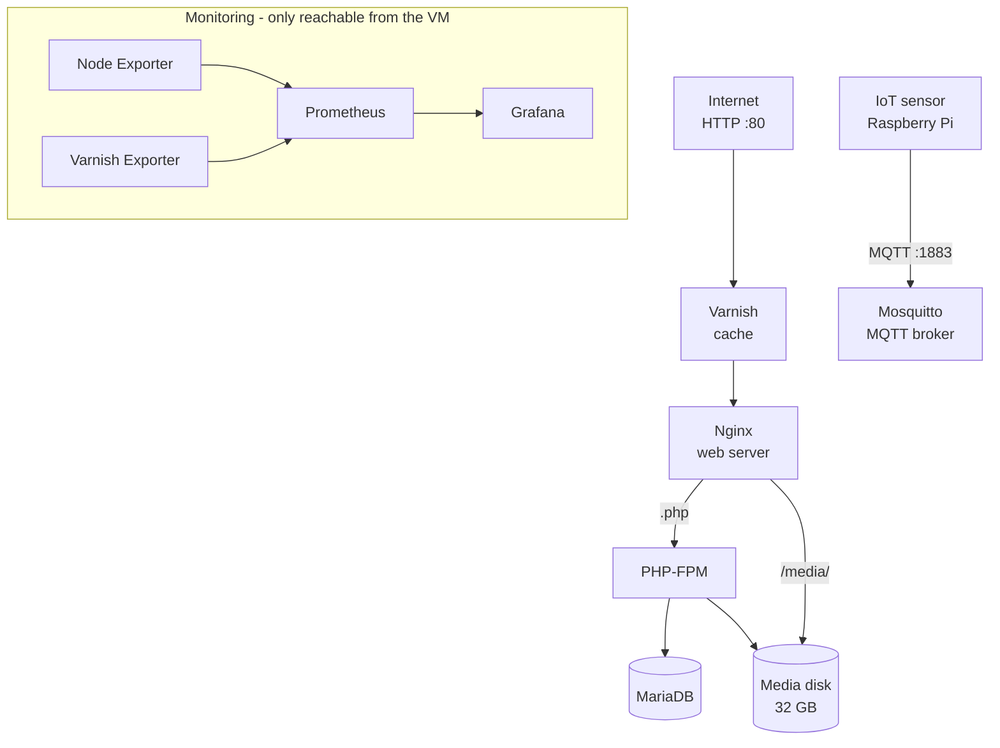

# LEMP Stack on Azure with Terraform

> **This is a LEMP stack** (Linux, Nginx, MariaDB, PHP), not LAMP.
>
> **Why "LAMP" appears in some places:** the assignment was called "LAMP i Azure" and allowed either Apache (LAMP) or Nginx (LEMP). The Azure resources, VM folders and users (`lamp-vm`, `lamp-rg`, `/opt/lamp`, `lampadmin`) were named after the assignment before we chose Nginx. They're kept on purpose: renaming a resource in Terraform deletes and rebuilds it, VM and disk included.

A web stack (Varnish → Nginx → PHP-FPM → MariaDB) running in Docker on an Azure VM. The whole thing, from network and firewall to the running containers, is deployed with a single `terraform apply`. It's monitored with Prometheus and Grafana and tested with Playwright.

**Status:** Work in progress. MQTT broker added (Opgave 5)
**Context:** Udvidet netværksteknologi, Opgave 3 + 5, 3rd semester, IT-Technology at Zealand (EASJ), autumn 2026. Group project with my study group (Emil and Kerim).

## Architecture



Every part runs as its own Docker Compose service on one Ubuntu 24.04 VM. Only Varnish (web, port 80) and Mosquitto (MQTT, port 1883) are open to the internet. MariaDB and PHP-FPM can't be reached from outside, and the Playwright tests check that.

**Why LEMP and not LAMP?** The assignment allowed either. I chose Nginx over Apache, with PHP running separately in PHP-FPM, which keeps the web server and the application in separate containers.

## Azure resources (`terraform/main.tf`)

| Resource | Purpose |
| --- | --- |
| Resource group `lamp-rg` | Holds everything. Region: Sweden Central, chosen because it was the cheapest for our student credits |
| Virtual network + subnet | Private network (`10.0.0.0/16`, subnet `10.0.1.0/24`) |
| Network security group | Firewall: HTTP (80) and MQTT (1883) open to everyone, SSH (22) only from known admin IP addresses |
| Static public IP | A fixed address for the VM |
| Network interface + NSG association | Connects the VM to the subnet and the firewall |
| Linux VM `lamp-vm` | Ubuntu 24.04 LTS, `Standard_D2as_v5`, SSH key login only |
| Managed disk (32 GB) | Separate storage for media files |

## Deployment: fully automated with Terraform

The app files, `docker-compose.yml`, `.env` and the Nginx, Varnish and PHP configs are base64-encoded and sent to the VM through `custom_data` (cloud-init), using Terraform's `templatefile()` with `terraform/cloud-init.tftpl`. On first boot the VM installs Docker, writes the files to `/opt/lamp/`, formats and mounts the media disk, and runs `docker compose up -d --build`. No manual SSH step is needed.

**Why this approach, and not the alternatives we tried or considered:**

- **Azure Key Vault** is the "proper" way to handle secrets in Azure, but it was ruled out for this assignment because of cost and setup complexity.
- **Manual SSH + `git clone` + copying `.env` by hand** was what we tried first. But only the person who ran those steps had a working `.env`, so teammates couldn't set up or maintain the stack themselves. That broke our collaboration, so we dropped it.
- **Full Terraform automation (chosen):** anyone with the Terraform config and Azure access can deploy the whole stack with one command. The trade-off is deliberate and worth stating: the secrets end up in the Terraform state file. That's why `.env`, `*.tfstate` and `*.tfvars` are all in `.gitignore` and never pushed to GitHub.

`lifecycle { ignore_changes = [custom_data] }` stops Terraform from rebuilding the whole VM every time a file in the template changes.

## Media storage

Uploaded media is kept off the VM's system disk and out of the database, on its own 32 GB Azure disk:

- **Mounted at `/mnt/media`** using its stable `by-lun` path, not `/dev/sdX`, which can change between boots.
- **Formatted only if empty.** cloud-init checks with `blkid` first, so a reboot never wipes the disk.
- **Owned by UID/GID 33**, which is `www-data` in the official PHP image.
- **Nginx mounts it read-only** and serves it directly at `/media/`. The `^~` location means files there are never passed to PHP, so an uploaded `.php` file can't be executed.
- **PHP mounts it read-write**, since it's the only part that creates files (uploads).

## MQTT (Opgave 5)

A Mosquitto broker lets IoT devices send sensor data to the VM. A broker works like a post office: a sensor (here a Raspberry Pi) posts a message to a topic such as `home/kitchen/temp`, and anyone subscribed to that topic receives it. The sender and receiver never talk to each other directly.

- Runs as its own container (`eclipse-mosquitto:2`) on port 1883.
- **No anonymous access:** clients must log in with a username and password (`allow_anonymous false`).
- Messages are kept across restarts (`persistence true`).
- The password file (`mosquitto/config/passwordfile`) is git-ignored and never pushed.

## Monitoring

| Service | What it does |
| --- | --- |
| Node Exporter | CPU, memory, disk, network and load from the VM, plus a custom metric for fail2ban bans (textfile collector) |
| Varnish Exporter | Cache hit ratio and requests per second |
| Prometheus | Collects all metrics every 15 seconds |
| Grafana | The "Azure VM Monitoring" dashboard, set up automatically through provisioning |

Prometheus and Node Exporter only listen on the VM's `localhost`, and the firewall only lets ports 80, 1883 and 22 in. Grafana is reached through an SSH tunnel, not from the open internet.

## Security

- **SSH:** key-based login only, no passwords. Port 22 is only open to known admin IP addresses. Each teammate has their own user account, and a shared `lampteam` group gives everyone access to `/opt/lamp`.
- **Secrets:** all passwords live in `.env` and are passed to the containers as environment variables. They're never written into the code or committed.
- **Internal services:** MariaDB and PHP-FPM have no published ports.
- **Hardening:** the VM was hardened against the CIS Benchmark (Level 1 Server profile) using Ubuntu Pro and the Ubuntu Security Guide (USG). I took a snapshot of the OS disk first, ran an audit, and reviewed the generated fix script line by line before applying it (all 407 rules). One rule was left out on purpose: removing `rsync`, since I wasn't sure nothing used it. The stricter default permissions afterwards broke the fail2ban metric in Grafana, which I tracked down and fixed. fail2ban blocks repeated failed logins.
- **No HTTPS (yet):** port 443 isn't configured, and the site is plain HTTP. This was a deliberate scope decision for the assignment, not an oversight.

## Tests

End-to-end tests with Playwright (`tests/e2e.spec.ts`), written by a teammate. They check that:

1. the front page loads through Varnish without errors,
2. Varnish is actually in front, by looking for its response headers,
3. MariaDB (3306) can't be reached from outside, and
4. PHP-FPM (9000) can't be reached from outside.

```
npm install
TARGET_URL=http://<public-ip> npm test
```

## How to deploy

You need Terraform, the Azure CLI and an SSH key.

1. Clone the repo, copy `.env.example` to `.env` in the root, and replace the example values with your own passwords:
   ```
   cp .env.example .env
   ```
2. Log in with `az login`.
3. Check the SSH key path and the allowed SSH IP addresses in `terraform/main.tf`.
4. Run:
   ```
   cd terraform
   terraform init
   terraform apply
   ```
5. Open `http://<public-ip>`. The page should say "It works! Connected to the database."
6. For MQTT, create the broker's password file on the VM (it isn't in the repo):
   ```
   docker compose exec mqtt mosquitto_passwd -c /mosquitto/config/passwordfile <username>
   docker compose restart mqtt
   ```

To run the stack locally without Azure: `docker compose up -d` in the root, with a `.env` file.

## Known issues / next steps

- **Monitoring and MQTT aren't in cloud-init yet.** The Prometheus, Grafana and Mosquitto config files were added after the first deploy and copied to the VM by hand, so a brand-new `terraform apply` would start those containers without their config. The fix is to add them to `cloud-init.tftpl`.
- **MQTT isn't encrypted.** Port 1883 is open to everyone, and although a password is required, the password and messages travel as plain text. Next step: TLS on port 8883, or limiting 1883 to known IP addresses.
- **The SSH key path and allowed IPs are hard-coded** in `main.tf`. They should be Terraform variables set in a `terraform.tfvars` file (already git-ignored), so each teammate can use their own and IP addresses stay out of the repo.
- **The first Playwright test has a TODO:** it checks for the absence of errors, but not yet for the success text.
- **Finish the CIS hardening:** re-run the audit to confirm the score after the fixes, and handle the rules USG can't fix automatically (SSH `AllowUsers`, `cron.allow`).
- **A real sensor:** connect the Raspberry Pi as an MQTT publisher, instead of the simulated sensor from the assignment.
- **HTTPS** with a certificate, for example Let's Encrypt.
